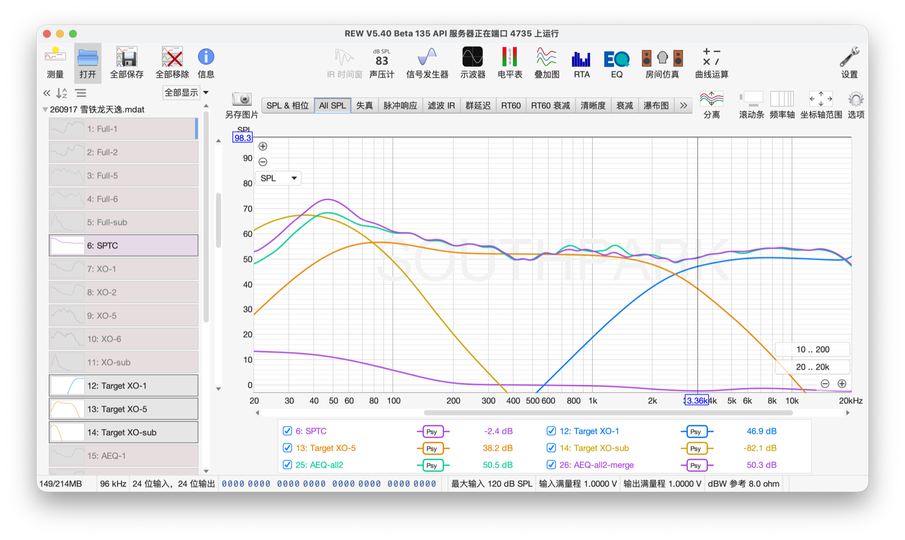
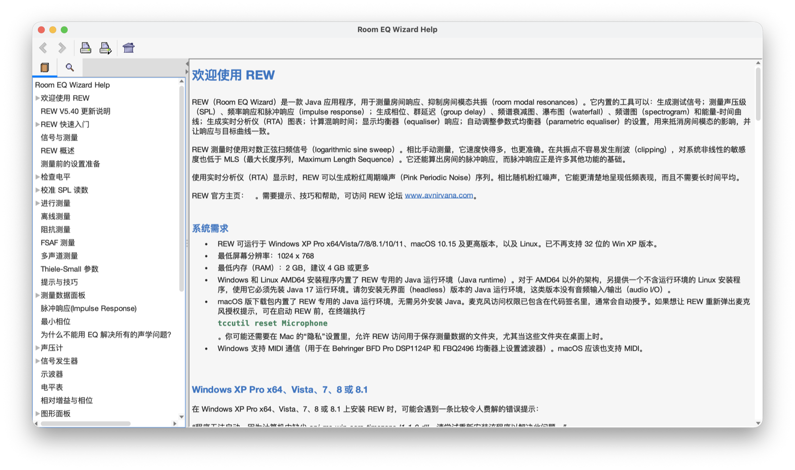

# REW 简体中文

[REW（Room EQ Wizard）](https://www.roomeqwizard.com/)的简体中文翻译。REW 由 John Mulcahy 开发。

当前译文版本 **v1.3.135.1**，基于 REW 5.40 beta 135。

[English version](#rew-simplified-chinese)

## 为什么做这个

REW 是一款免费的声学测量软件。在国内，汽车音响和家庭影院的调音师、扬声器厂和功放厂的工程师，很多做声学测量的人都在用它。可是它的英文帮助有十万多个单词，不少人读起来吃力。

我是厦门南方公园的 Jacky，平时做汽车音响的改装升级和调音培训。这次翻译的做法是：

- 从英文原文开始，逐行重新翻译了界面和全部 67 页帮助。
- 术语不只看单一来源。参考的来源有[术语在线](https://www.termonline.cn)（全国科学技术名词审定委员会）、国内声学教材和国家标准、中文维基百科，以及测量设备厂商（如 NTi Audio）的中文资料，同时考虑国内学术上的通常叫法和行业里的习惯叫法。一个概念只用一个名字，例如 Clarity 和 Definition 分别叫“清晰度”和“明晰度”，不混用。
- 帮助文件和汉化界面里的用词保持一致。
- 专业术语第一次出现时附上英文，例如“群延迟（group delay）”，方便理解和核对。
- 按中文的阅读习惯，把原文里的长句拆短，尽量做到准确、通顺、自然。

一个人完成这样的工作，难免有错，也一定有翻译得不够好的地方。你在用 REW 时，如果发现哪里翻译得不对、读不懂，欢迎提 Issue 或 Pull Request，一起把中文版做好。

## 维护方式

本仓库经 REW 作者 John Mulcahy 同意建立，目前由我一个人维护。REW 已经内置简体中文。这里收到的改动，由我整理后交给 John，随 REW 以后的版本发布。

## 目录

| 目录 | 内容 |
| --- | --- |
| `bundles/` | 34 个界面文件 `*_zh.properties`，旁边是对应的英文原文 `*_en_GB.properties` |
| `help_zh/` | 帮助窗口左侧的目录树 `WizardHelpTOC.xml` 和帮助跳转表 `Map.jhm` |
| `help_zh/html/` | 67 页帮助 |
| `help_zh/html/dialogs/` | 15 页弹窗帮助 |
| `help/html/` | 英文帮助原文，供对照 |

`api.html` 不翻译，所以 `help_zh` 里没有它。搜索索引和帮助页用到的图片不在本仓库里。

## 参与改进

发现翻译错了或看不懂的地方，请提一个 Issue。写清你用的 REW 版本、出问题的窗口或帮助页，再附上相关的文字或截图。如果你有建议的译法，也欢迎一起写上。

熟悉 GitHub 的话，也可以直接发 Pull Request。只改中文文件，同名的英文文件放在旁边供你对照。用词请和 REW 界面保持一致，拿不准时先在 Issue 里问。

英文文件来自 REW，请不要修改。英文本身有错，也请提 Issue，我转告 John。REW 软件本身的使用和功能问题，请到 [REW 官方论坛](https://www.avnirvana.com/forums/official-rew-room-eq-wizard-support-forum.10/)提问。

## 许可

本项目的中文翻译文字使用 MIT 许可证，见 [LICENSE](LICENSE)。

英文原文（`bundles/*_en_GB.properties` 和 `help/` 下的文件）是 John Mulcahy 的作品，经他同意放在这里供对照，不适用 MIT 许可证。中文文件里保留的原有内容，例如第一行 John 的版权声明，权利也保持不变。

## 致谢

感谢 John Mulcahy 开发了 REW，免费给大家使用，并同意把这份翻译放在这里。也感谢台湾的林佑叡和宁波小黑音频测试，在汉化过程中给了我很大的帮助。

---

# REW Simplified Chinese

This is the Simplified Chinese translation of [REW (Room EQ Wizard)](https://www.roomeqwizard.com/). REW is developed by John Mulcahy.

Current translation version: **v1.3.135.1**, based on REW 5.40 beta 135.

## Why I did this

REW is free-to-use acoustic measurement software. In China, many people who do acoustic measurement use it, such as car audio and home theater tuners, and engineers at speaker and amplifier factories. But the English help is more than 100,000 words, and quite a few people find it hard to read.

I'm Jacky Shu from SouthPark in Xiamen, China. I do car audio upgrades and teach car audio tuning. This is how I did the translation:

- I translated the interface and all 67 help pages again, line by line from the English.
- For terms, I don't rely on one source. My sources include [Termonline](https://www.termonline.cn) (run by the China National Committee for Terms in Sciences and Technologies), Chinese acoustics textbooks and national standards, Chinese Wikipedia, and Chinese documents from measurement equipment makers such as NTi Audio. I also consider the usual names in Chinese academic work and the common names in the industry. One idea has only one name. For example, Clarity is always 清晰度 and Definition is always 明晰度. The two are never mixed.
- The help and the Chinese interface use consistent wording.
- When a technical term appears the first time, the English is added after it, for example 群延迟 (group delay). This makes it easier to understand and check.
- Following Chinese reading habits, I split long sentences in the original into shorter ones, and tried to make the Chinese accurate, clear and natural.

When one person does this kind of work, there will be mistakes, and some parts are surely not translated well enough. If you find a wrong or unclear translation while using REW, you are welcome to open an issue or send a pull request. Let's make the Chinese version better together.

## How it is maintained

This repository was set up with the agreement of John Mulcahy, the author of REW. For now, I maintain it by myself. REW already includes Simplified Chinese. I sort out the changes received here and pass them to John. They will be released with future REW versions.

## What is here

| Folder | Content |
| --- | --- |
| `bundles/` | 34 interface files `*_zh.properties`. The English files `*_en_GB.properties` are beside them. |
| `help_zh/` | The contents tree on the left of the help window, `WizardHelpTOC.xml`, and the help map, `Map.jhm` |
| `help_zh/html/` | 67 help pages |
| `help_zh/html/dialogs/` | 15 dialog help pages |
| `help/html/` | The English help pages, for comparing |

`api.html` is not translated, so it is not in `help_zh`. The search index and the images used by the help pages are not in this repository.

## How to help

If you find a wrong translation or a place you can't understand, please open an issue. Tell me your REW version and the window or help page with the problem, and add the related text or a screenshot. If you have a suggested translation, you are welcome to add it too.

If you know GitHub, you can also send a pull request. Change only the Chinese file. The English file with the same name is there for you to compare. Please use the same words as the REW interface. If you are not sure which word to use, ask in an issue first.

Please don't edit the English files. They come from REW. If you find a problem in the English itself, please open an issue too, and I will pass it on to John. For questions about how to use REW or about its features, please go to the [official REW forum](https://www.avnirvana.com/forums/official-rew-room-eq-wizard-support-forum.10/).

## License

The Chinese translation text in this project is under the MIT License. See [LICENSE](LICENSE).

The English files (`bundles/*_en_GB.properties` and the files in `help/`) are the work of John Mulcahy. They are here with his permission, so people can compare. They are not under the MIT License. The rights to the original content kept in the Chinese files, such as John's copyright line at the top, stay unchanged.

## Thanks

Thanks to John Mulcahy for developing REW, for making it free for everyone, and for letting me put this translation here. Thanks also to 林佑叡 from Taiwan and 宁波小黑音频测试 for their great help during the translation.
